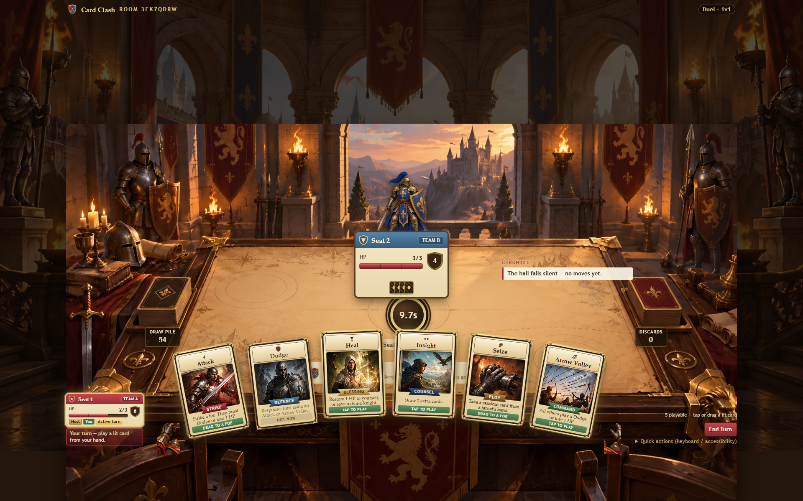
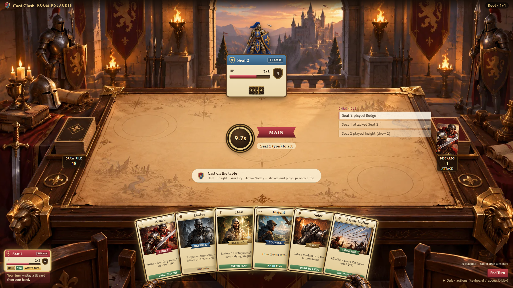
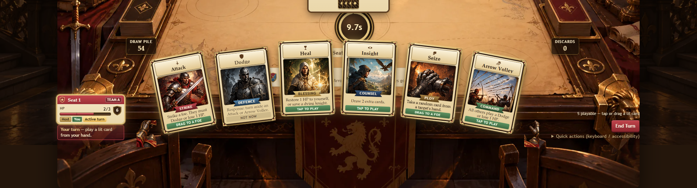
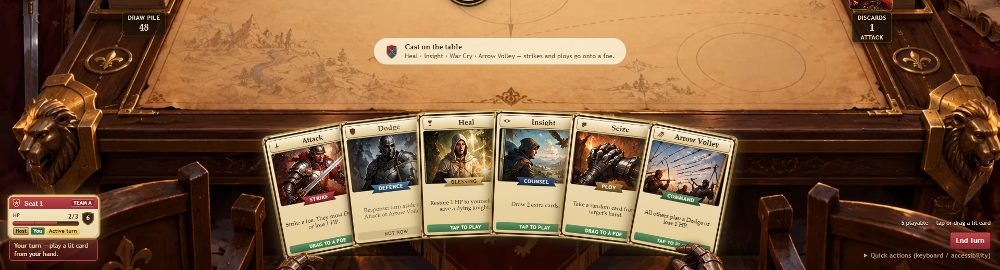

# Process overview

I developed Card Clash through human-directed changes. My decisions concerned scope, constraints, rejected attempts and acceptance. Claude Code implemented the early work; I switched UI repairs to Codex when repeated visual revisions failed to converge. I used original AI-generated artwork for the medieval setting. This account separates committed development from later local, uncommitted experiments and distinguishes engineering evidence from my visual judgments.

## Establishing a bounded system

The original concept was a multiplayer strategy game about coordination. [9f4212a](https://github.com/comp4020-agentic-coding-studio/comp4020-final-posture627k/commit/9f4212a) established its direction and agent harness before application logic; [b675681](https://github.com/comp4020-agentic-coding-studio/comp4020-final-posture627k/commit/b675681) recorded the Node/Hono/SQLite architecture in [the Crit 8 decision record](docs/crit-8-architecture.md).

The stack kept implementation small: Node executed TypeScript directly, Hono supplied routing, and SQLite held authoritative state on the persistent volume. Avoiding a frontend framework, ORM and bundler reduced moving parts, while native execution restricted usable TypeScript syntax. Server-issued anonymous identity supported separate players without accounts, at the cost of no identity recovery after clearing cookies or changing devices. These boundaries gave the agent a concrete implementation contract.

Incremental slices established identity, joining and unanimous approval before starting. Historical-schema testing in [e456218](https://github.com/comp4020-agentic-coding-studio/comp4020-final-posture627k/commit/e456218) caught a temporal-dead-zone migration failure. During offline-production work ([d4874db](https://github.com/comp4020-agentic-coding-studio/comp4020-final-posture627k/commit/d4874db)), mixing synthetic and real timestamps exposed a fault in my test design; controlled fake timers corrected it. I learned to test previous database states and consistent clocks, not only fresh installations.

The 81-test suite passed, but human inspection found raw HTML, an undersized battlefield and long-link wrapping problems. [2ccf8ed](https://github.com/comp4020-agentic-coding-studio/comp4020-final-posture627k/commit/2ccf8ed) corrected presentation while preserving gameplay. That established a recurring distinction between technical correctness and usability.

## Keeping realtime subordinate to authority

Before implementation, [f4a14cb](https://github.com/comp4020-agentic-coding-studio/comp4020-final-posture627k/commit/f4a14cb) recorded the SSE contract in [the Crit 9 decision record](docs/crit-9-architecture.md). SQLite remained authoritative; events only requested a refetch. Hono's existing SSE support added no dependency, and an in-process subscriber registry suited the single-machine deployment. Multiple instances would require shared notification infrastructure.

Participant authorization, coalesced refreshes and notifications after effective committed mutations followed that contract ([4b117ead](https://github.com/comp4020-agentic-coding-studio/comp4020-final-posture627k/commit/4b117ead)). Registering abort handling before asynchronous suspension prevented a cleanup race; coalescing prevented older responses overwriting newer state. Two independent identities exercised notification, refetch and unauthorized-subscription rejection against a running container. These checks established synchronization and access control, not an intuitive multiplayer experience.

## Replacing the product while preserving infrastructure

The strategy prototype demonstrated persistence but lacked a complete gameplay loop: resources had no meaningful sink or victory condition. I cancelled that direction. Poker Lab reused identity, transactions, SSE and deployment; [6f4689f](https://github.com/comp4020-agentic-coding-studio/comp4020-final-posture627k/commit/6f4689f) established its table-and-seat foundation with additive migrations. Poker subsequently remained as legacy code, not the final product.

I chose Card Clash to bound a comprehensible multiplayer loop: three modes, eight cards, HP, responses, rescue, discard and team victory. [deba1de](https://github.com/comp4020-agentic-coding-studio/comp4020-final-posture627k/commit/deba1de) froze [the rules](docs/card-clash-rules.md), providing a reference against which to reject invented behavior. Separate slices implemented pure resolution, transactional persistence, HTTP validation ([a155386](https://github.com/comp4020-agentic-coding-studio/comp4020-final-posture627k/commit/a155386)), room-scoped realtime ([be378c5](https://github.com/comp4020-agentic-coding-studio/comp4020-final-posture627k/commit/be378c5)) and durable deadlines ([98445e7](https://github.com/comp4020-agentic-coding-studio/comp4020-final-posture627k/commit/98445e7)).

The server determines outcomes and filters private hands before transmission. Ten-second deadlines persist in SQLite; overdue work reconciles when a sleeping Fly instance resumes. Browser countdowns and effects cannot authorize actions. Privacy, atomic transitions and reproducible rules remained acceptance constraints throughout visual work.

## Choosing and correcting the interaction

The playable browser loop landed in [db92302](https://github.com/comp4020-agentic-coding-studio/comp4020-final-posture627k/commit/db92302). Later, my screenshots showed dashboard panels, tiny illustrations and weak spatial relationships. I directed the agent toward a knight holding cards at a physical table. Card-first input connected the player's hand to targets, while click, tap and keyboard paths remained available. This was a design intention, not yet evidence that new players found dragging intuitive.

Early CSS and SVG decoration passed tests but failed my visual comparison with the concept. Separate castle-hall and war-table paintings improved the artwork, yet placing the painted interior inside another background produced a framed picture. The environment needed to define the scene's coordinate system. P4 added opponent poses and brief effects triggered by confirmed public events; it still produced cropped titles, unstable geometry and composite body artwork obscuring cards.

Two [recovered before/after comparisons](docs/evidence/before-after/README.md) make this concrete. The first contrasts the inset, double-background table at [aa66609](https://github.com/comp4020-agentic-coding-studio/comp4020-final-posture627k/commit/aa66609) against the full-screen war table at [393cc48](https://github.com/comp4020-agentic-coding-studio/comp4020-final-posture627k/commit/393cc48):

| Before (aa66609) | After (393cc48) |
|---|---|
|  |  |

The second isolates the same pair's hand region: flat cards with no player presence, against the same cards held in a rotated fan by first-person gauntlets:

| Before (aa66609) | After (393cc48) |
|---|---|
|  |  |

Both screenshots were captured by the agent driving that repair session, not by me directly; they show what that commit pair actually rendered; my own acceptance judgment about the result is recorded separately below, not restated by the images.

P5.1–P5.2 repairs exposed another workflow problem: attention to portrait layout had left ordinary desktop play unresolved. I reprioritized desktop composition while preserving functional portrait support. After repeated Claude Code revisions, I handed Codex a root-cause audit with explicit instructions to preserve uncommitted work, retain the unified fan and verify phases and viewpoints.

I made normal four-to-six-card desktop play the main visual acceptance case, with other phases and portrait support checked alongside it. My repair prompts prohibited changes to rules, persistence, SSE and timers, and required decorative hands to remain non-interactive. This narrowed the agent's task to presentation and input defects rather than another product redesign.

P5.3 separated fan geometry from HUD widths, improved pointer dragging and replaced composite body art with transparent gauntlets anchored to outer cards. The [local audit](docs/card-clash-p53-audit.md) records implementation and regression checks. P5.4–P5.5 moved side controls inward and enlarged the hands; P5.6 adjusted arm angles, contextual prompts and text contrast. My subsequent six-card review found the view readable, while one card exposed controls moving too far inward as the fan shrank. That remains a targeted refinement, not a resolved result.

## Evidence and release boundary

Later agent reports recorded 367 passing tests, Docker smoke checks and Chromium checks at desktop and mobile dimensions. Most layout scenarios used deterministic filtered-state fixtures; a separate Docker smoke exercised the real server and dealt hands. I distinguish these from my screenshot judgments: measured bounds, successful submissions and privacy checks cannot establish believable anatomy or intuitive play. Corrections also reached the local UI regression tests and [browser-check script](scripts/card-clash-browser-check.cjs), providing repeatable checks beyond another visual retry.

For Crit 10, [00544ac](https://github.com/comp4020-agentic-coding-studio/comp4020-final-posture627k/commit/00544ac) added server-derived logs and privacy constraints. Two classmates independently exposed drop, discard, navigation and HUD problems in [9276b65](https://github.com/comp4020-agentic-coding-studio/comp4020-final-posture627k/commit/9276b65) ([record](docs/card-clash-playtest.md)). I directed focused repairs in [18ad415](https://github.com/comp4020-agentic-coding-studio/comp4020-final-posture627k/commit/18ad415), updating CLAUDE.md and tests. Their follow-up confirmed targetless use and discard limits repaired, but found the Lobby button small. The original trace remained unavailable; a later [41-action capture](docs/evidence/crit10-retest/README.md) distinguishes two identities. It cannot establish gestures, discard quantities or live narration. [Crit 10](reflections/crit-10.md) records that distinction. The README's references frame current evaluation, without claiming an earlier literature-led design.

That retest's open Lobby finding (L1) is addressed in this release: the Lobby control now has a 44×44px-minimum touch target and a native `<dialog>` confirmation ("Return to lobby? Your match will continue, and you can rejoin.", with Stay and Return to Lobby actions), replacing the earlier browser `confirm()`. It reuses the Help dialog's existing focus-trap and focus-restore pattern rather than introducing a second one. Regression tests cover both cancellation and confirmed navigation, and `git diff --check`, `pnpm typecheck`, `pnpm check` and `pnpm check:evidence` pass; a real-Chromium check at 1920×1080 and 390×844 confirmed the touch target size, dialog copy, keyboard Tab-trap, Escape-to-close and state/identity preservation after resuming. No classmate has yet retested this change; it is an engineering fix awaiting the same kind of independent confirmation the earlier findings received.

P5.x was kept local and uncommitted during visual review; this test candidate packages those changes for human testing. [393cc48](https://github.com/comp4020-agentic-coding-studio/comp4020-final-posture627k/commit/393cc48) records that packaging, not separate historical commits for each visual iteration. Portable [P5.6 evidence](docs/evidence/p56/README.md) preserves the screenshots and their limitations. A running preview is not a deployed release, and screenshot acceptance does not replace two-person, URL-only playtesting. The working tree, assets, secret scans, database backup and course checks are reviewed using [the release checklist](docs/card-clash-release-checklist.md). Rematch, accounts, replacement players and extra cards remain excluded. The project taught me to combine bounded rules and server guarantees with human judgment about the experience those guarantees support.
