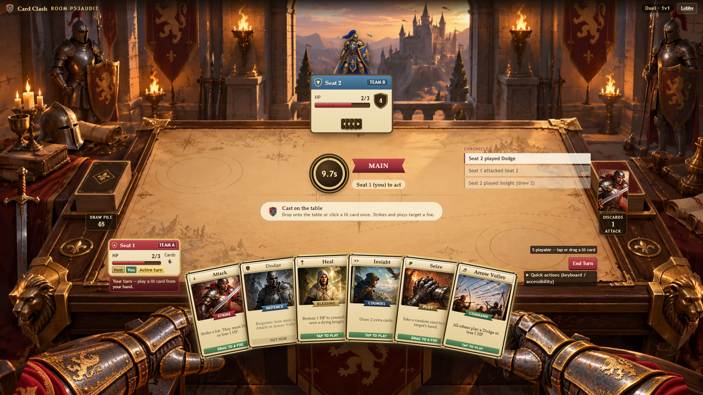
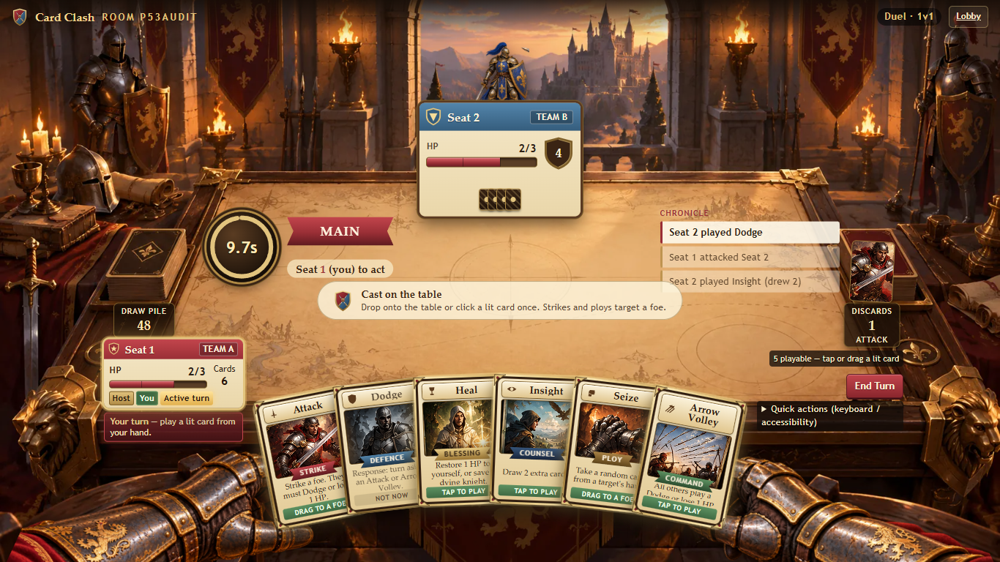
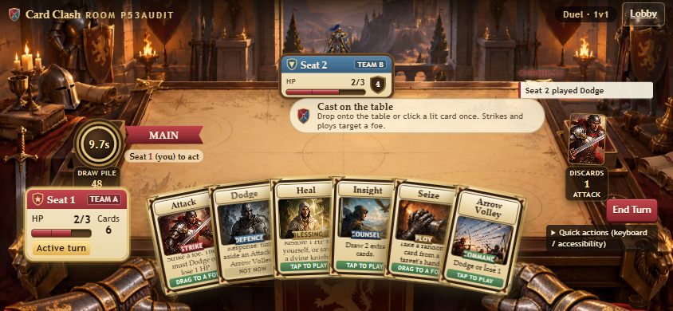
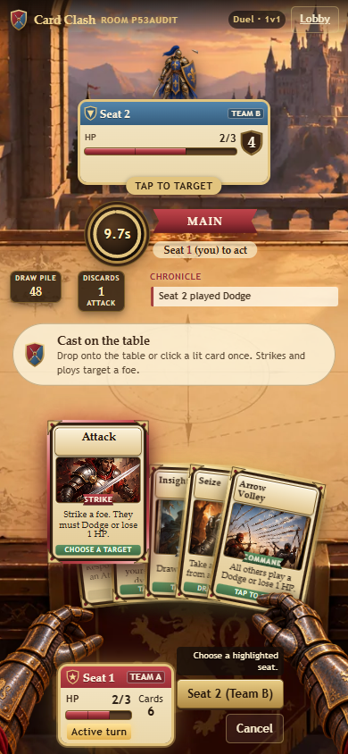

# Card Clash — repairs from the 17 October playtest

Status: pre-release verification snapshot, captured locally before publication.
Current release status is recorded by the repository's GitHub Actions.
The [original human record](card-clash-playtest.md) remains separate from
the automated checks below. No classmate retest or final visual acceptance
of these changes has occurred.

## Report to implementation

| Finding | Root cause / resulting change | Regression evidence |
|---|---|---|
| U1: targetless table drops fail | `resolveDropTarget` formerly required hitting the narrow prompt. `.table-drop-area` now covers the painted table's central 52% width, from 40% to 80% height in the same cover-scaled scene. It highlights only for the current card's compatible action. Geometry is used through its `pointer-events:none` overlay; cards, HUD, navigation and opponent targets retain their own hit tests. | Chrome checks Heal, Insight, War Cry and Arrow Volley: drop outside the prompt, one deliberate click, and invalid drag followed by a click, across all four viewports. Each produces exactly one expected POST. |
| U2: discard below HP | UI selection was unbounded; the engine checked ownership but not the number removed. `discardCards` rejects more than the remaining excess, even if sent directly over HTTP. UI caps selection, keeps selected cards enabled for deselection and shows selected/required counts and `Limit reached`. | At 2 HP/5 cards, 4 and 5 are rejected without changing state/version/deadline; 3 succeeds. Partial discards remain supported and the existing timer tests pass. |
| U3: no lobby navigation | `#return-lobby` is available during and after play. It opens the existing lobby with a `resume` URL; `#resume-room` returns to the match. Cookie identity, saved state and running timers are preserved. There is no new reset, resignation or rematch rule. | Real Chrome roundtrips cover active and completed fixtures at every viewport. Two independent browsers also exercise a real Docker match and return with the same identity. |
| U4: small self HUD | `.self-hud` grows from 170 to 190 px on desktop; its fan-relative left offset grows by the same 20 px, retaining a 14 px gap. Seat text grows .82 to .94 rem, HP value .78 to .96 rem, HP bar 7 to 9 px. An explicit `Cards` label and count replace the miniature self shield. Small viewports keep their compact footprint. | Desktop 4/5/6-card cases assert HUD/fan separation; screenshots preserve the actual rendered result. |

The browser pass also caught clipped Cancel and discard-confirm controls.
Target selection now omits redundant helper text/labels; portrait targeting
has 112 px available height, and the discard wording is shorter. Both
controls remain reachable in the final browser pass. Fan positions, hands,
artwork, database schema, SSE and timer implementation were not changed.
The discard specification and CLAUDE.md now protect the clarified boundary.

## Verification and limits

- `git diff --check`, `pnpm typecheck`, `pnpm check`: pass; 377 tests in 22
  files, including four new tests shown failing before implementation.
- `pnpm check:evidence`: pass for current commit references. This does not
  imply a completed Crit 10 reflection or log-based human observation.
- Real Chrome: 84 layout cases at 1920×1080, 1366×768, 844×390 and 390×844;
  normal 4/5/6-card play, both viewpoints, selected/targeted cards, defence,
  group response, rescue and discard. Mouse, keyboard, touch, drag cancel,
  resize, 48 direct-card gestures and eight lobby roundtrips pass.
- Layout/input cases use deterministic, filtered API fixtures. A separate
  real Docker match with two independent Chrome contexts verifies one
  pointer Attack, response, cross-browser SSE, hidden-hand privacy, rejected
  over-discard, legal discard and identity-preserving lobby return.
- The exact originally reported double-click card/state was not supplied.
  No universal double-click rule is established; the four direct types now
  pass one-click and drag checks. Human retesting remains necessary.
- No new next-day/redeploy test, deployment or final visual acceptance is
  claimed. Existing single-card spacing is outside this repair.

[Machine-readable summary](evidence/crit10-repair/verification.json).
Screenshots are fixture renders, not screenshots of the classmates' session:

| Desktop | Laptop |
|---|---|
|  |  |

| Landscape | Portrait target controls |
|---|---|
|  |  |
