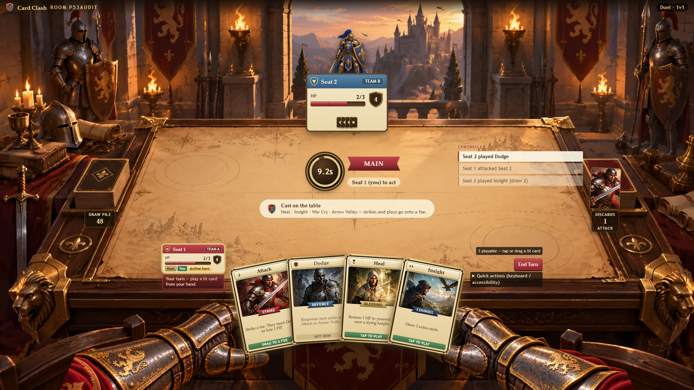
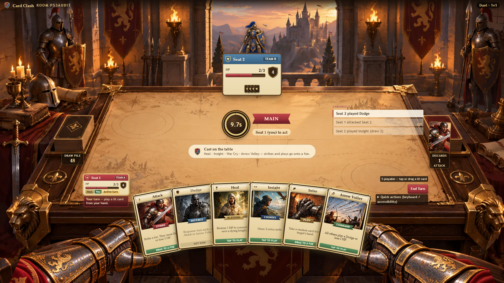
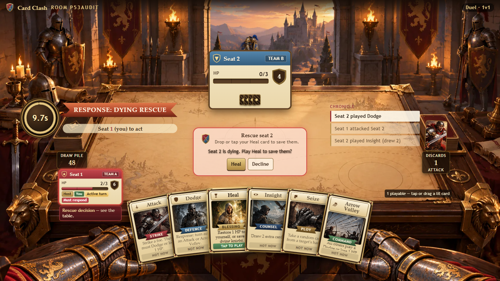
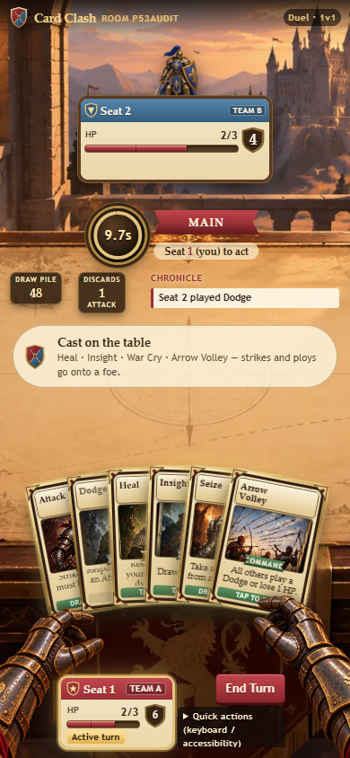

# P5.6 browser evidence

These are preserved **automated local Chromium** composition screenshots from
P5.6, using deterministic, filtered projection fixtures. They are not a
production session, a two-person playtest or final visual acceptance.
`verification-summary.json` records that historical run; its 367-test total
predates the six Crit 10 logging/entry tests added for the release candidate.
The UI source SHA256 matches the source packaged with this candidate.

The render/input matrix covered 1920×1080, 1366×768, 844×390 and 390×844.
The separate Docker smoke used the real server and dealt hands. Human
URL-only testing and the single-card control-spacing refinement remain pending.

